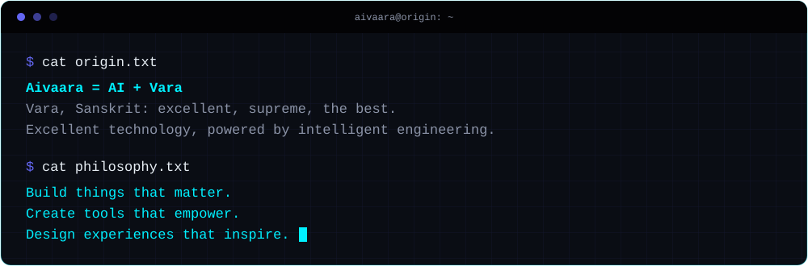

<div align="center">



<a href="https://aivaara.in">
  
</a>

<br/>

**`[ SYSTEM ONLINE ]`** &nbsp; **`[ SIX FRONTIERS ]`** &nbsp; **`[ ZERO COMPROMISE ]`**

<br/>

<a href="https://aivaara.in"><b>▸ ENTER aivaara.in</b></a> &nbsp;·&nbsp; <a href="https://github.com/aivaara"><b>▸ BROWSE REPOSITORIES</b></a> &nbsp;·&nbsp; <a href="#contribute"><b>▸ JOIN THE BUILD</b></a>

</div>

<br/>

<div align="center">
  
</div>

<br/>

## `01` &nbsp; ◈ &nbsp; TRANSMISSION: WHO WE ARE

> **Aivaara is an engineering organization built for the hard problems.**
> We fuse **artificial intelligence**, **systems engineering** and **automation** into technology that is **fast, precise and built to last**.

We do not ship demos. We ship **products with a pulse**: intelligent, scalable, and crafted down to the last detail.

**Aivaara is a launchpad for developers, designers, researchers and builders** who would rather solve a difficult problem properly than a simple one quickly.

**`COMMAND`** &nbsp; Abhishek Maurya, Founder and Lead Engineer

<br/>

## `02` &nbsp; ◈ &nbsp; THE SIX FRONTIERS

**Six domains. One standard. Every system engineered to perform.**

<table>
  <tr>
    <td width="33%" valign="top">
      <b>🟢 &nbsp;INTELLIGENCE</b><br/>
      <b>AI and Autonomous Agents</b><br/>
      <sub>Agents that <b>think, decide and act</b>. LLM tooling, prompt systems and automation that does real work.</sub><br/><br/>
      <code>STATUS: ACTIVE</code>
    </td>
    <td width="33%" valign="top">
      <b>🟡 &nbsp;QUANT</b><br/>
      <b>Quantitative Systems</b><br/>
      <sub>Algorithmic modeling and numerical engines where <b>every decimal is accountable</b>.</sub><br/><br/>
      <code>STATUS: BUILDING</code>
    </td>
    <td width="33%" valign="top">
      <b>🟢 &nbsp;ORBITAL</b><br/>
      <b>Space Computing</b><br/>
      <sub>Orbital simulation and autonomous guidance. Home of <b>ARES</b>, our rocket landing engine.</sub><br/><br/>
      <code>STATUS: ACTIVE</code>
    </td>
  </tr>
  <tr>
    <td width="33%" valign="top">
      <b>🟡 &nbsp;CORE</b><br/>
      <b>Bare Metal Infrastructure</b><br/>
      <sub>C++ and Linux at the <b>edge of the hardware</b>. No abstraction we cannot explain.</sub><br/><br/>
      <code>STATUS: BUILDING</code>
    </td>
    <td width="33%" valign="top">
      <b>🔵 &nbsp;FLOW</b><br/>
      <b>FinTech Architecture</b><br/>
      <sub>High throughput engines designed to <b>hold the line under extreme load</b>.</sub><br/><br/>
      <code>STATUS: PLANNED</code>
    </td>
    <td width="33%" valign="top">
      <b>🔵 &nbsp;VITAL</b><br/>
      <b>Healthcare Intelligence</b><br/>
      <sub>Data driven systems that <b>sharpen clinical and operational decisions</b>.</sub><br/><br/>
      <code>STATUS: PLANNED</code>
    </td>
  </tr>
</table>

<sub>🟢 Active &nbsp; 🟡 Building &nbsp; 🔵 Planned &nbsp; 🟣 Ongoing research</sub>

<br/>

## `03` &nbsp; ◈ &nbsp; FLAGSHIP MISSIONS

| Mission | Frontier | Briefing | Status |
|:--|:--|:--|:--|
| **ARES** | Space Computing | **Autonomous vertical rocket landing**, simulated end to end. Guidance, control and touchdown in one engine. | 🟢 **ACTIVE** |
| **Aivaara Sentinel** | Systems and Intelligence | **Always on monitoring and intelligence.** Built to watch, detect and respond. | 🟢 **ACTIVE** |

<br/>

## `04` &nbsp; ◈ &nbsp; THE ECOSYSTEM

**Five modules. One shared foundation.**

| Module | Mission | Status |
|:--|:--|:--|
| [**aivaara-core**](https://github.com/aivaara/aivaara-core) | The **backbone**: shared utilities, configuration and workflow templates powering every project. | 🟡 **In progress** |
| [**aivaara-ui**](https://github.com/aivaara/aivaara-ui) | **Motion first interfaces.** Animated React and Next.js components on Tailwind and Framer Motion. | 🔵 **Planned** |
| [**aivaara-ai**](https://github.com/aivaara/aivaara-ai) | The **intelligence layer**: LLM tools, prompt systems, agents and automation scripts. | 🔵 **Planned** |
| [**aivaara-devtools**](https://github.com/aivaara/aivaara-devtools) | **Developer velocity.** CLIs, boilerplates, templates and scripts that remove friction. | 🔵 **Planned** |
| [**aivaara-labs**](https://github.com/aivaara/aivaara-labs) | The **frontier lab**: prototypes, new architectures and performance experiments. Where ideas break first. | 🟣 **Ongoing** |

<br/>

## `05` &nbsp; ◈ &nbsp; STACK AND ARCHITECTURE

**Precision tools for precision work.**

<table>
  <tr>
    <td width="170"><b>⚙ SYSTEMS</b></td>
    <td>
      
    </td>
  </tr>
  <tr>
    <td><b>🧠 AI AND DATA</b></td>
    <td>
      
    </td>
  </tr>
  <tr>
    <td><b>🖥 FRONTEND</b></td>
    <td>
      
    </td>
  </tr>
  <tr>
    <td><b>🛰 BACKEND</b></td>
    <td>
      
    </td>
  </tr>
  <tr>
    <td><b>🗄 DATA LAYER</b></td>
    <td>
      
    </td>
  </tr>
</table>

<sub><b>AI LAYER:</b> LLMs · Transformers · LangChain · Vector databases · Agent frameworks</sub>

<br/>

## `06` &nbsp; ◈ &nbsp; ENGINEERING DOCTRINE

**Seven laws we build by.**

| | Law | Directive |
|:-:|:--|:--|
| `01` | **CLEAN CODE** | Readable. Modular. **Built to be maintained, not rescued.** |
| `02` | **PERFORMANCE FIRST** | **Speed is a feature.** Fast apps, optimized APIs. |
| `03` | **SCALABLE ARCHITECTURE** | Design for **tomorrow's load** today. |
| `04` | **DESIGN MATTERS** | **Sleek interfaces, smooth motion**, zero visual noise. |
| `05` | **AI NATIVE THINKING** | **Automate** wherever it earns its place. |
| `06` | **OPEN SOURCE SPIRIT** | **Share what we learn.** Knowledge compounds. |
| `07` | **QUALITY OVER QUANTITY** | **Intention over speed.** Build it right, then build it again better. |

<br/>

## `07` &nbsp; ◈ &nbsp; COMMAND

<table>
  <tr>
    <td width="120" align="center" valign="top">
      
    </td>
    <td valign="top">
      <b>ABHISHEK MAURYA</b><br/>
      <code>FOUNDER AND LEAD ENGINEER</code><br/><br/>
      <b>Full stack developer. AI/ML builder. Vision driven.</b><br/>
      Sets the <b>direction, architecture and standard</b> behind every Aivaara system.<br/><br/>
      <a href="https://aivaara.in"><b>▸ aivaara.in</b></a>
    </td>
  </tr>
</table>

<br/>

<a id="contribute"></a>

## `08` &nbsp; ◈ &nbsp; JOIN THE BUILD

**We build in the open. Every contribution moves the mission forward.**

```text
01  FORK       the repository
02  BRANCH     create a feature branch
03  COMMIT     ship your changes
04  PULL       open a pull request
```

**Where you can make impact:** bug fixes · documentation · new features · UI components · performance tuning

If our work helps you, **⭐ star it, share it, follow along.** Every star fuels the next build.

<br/>

<div align="center">

**`AIVAARA`** &nbsp;//&nbsp; **ENGINEERING THE INTELLIGENT FUTURE** &nbsp;//&nbsp; <a href="https://aivaara.in">aivaara.in</a>

<sub>Build things that matter. Create tools that empower. Design experiences that inspire.</sub>

</div>
